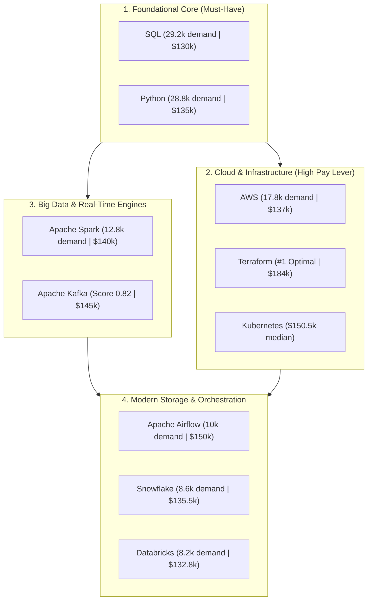

# Project 1: Exploratory Data Analysis (EDA) — Data Engineering Job Market

An in-depth, SQL-driven exploratory data analysis investigating the job market landscape for **Remote Data Engineers**. This project evaluates demand volumes, compensation levels and optimal career skills using advanced SQL queries executed on a **MotherDuck-hosted DuckDB OLAP database**.

---

## Architecture & Project Overview

The analysis follows a modern analytical pipeline leveraging columnar OLAP execution to extract insights from raw job postings and skill dimension models.


### Data Model & Environment
- **Database Engine**: [DuckDB](https://duckdb.org/) / [MotherDuck](https://motherduck.com/) OLAP Engine
- **Primary Fact Table**: `job_postings_fact` (job metadata, titles, remote status, average annual salaries)
- **Dimension & Bridge Tables**: `skills_job_dim` (bridge table linking jobs to skill IDs), `skills_dim` (skill names and categories)
- **Target Audience Filter**: Remote positions (`job_work_from_home = True`) for the role of **Data Engineer** (`job_title_short = 'Data Engineer'`).

---

## Table of Contents

1. [Task 1: Top In-Demand Skills](#task-1-top-in-demand-skills)
2. [Task 2: Highest-Paying Skills](#task-2-highest-paying-skills)
3. [Task 3: Most Optimal Skills (Balancing Demand & Salary)](#task-3-most-optimal-skills-balancing-demand--salary)
4. [Strategic Insights & Recommendations](#strategic-insights--recommendations)
5. [How to Run the Queries](#how-to-run-the-queries)

---

## Task 1: Top In-Demand Skills

### Business Question
> *What are the most requested skills for remote Data Engineers in the current job market?*

Understanding the skills in highest demand helps professionals focus their learning on technologies with the widest market adoption and greatest employment security.

### SQL Implementation: [`01_top_demanded_skills.sql`](./01_top_demanded_skills.sql)

```sql
SELECT 
    sd.skills,
    COUNT(jpf.*) AS demand_count
FROM job_postings_fact jpf
INNER JOIN skills_job_dim sjd ON jpf.job_id = sjd.job_id
INNER JOIN skills_dim sd ON sjd.skill_id = sd.skill_id
WHERE
    jpf.job_title_short = 'Data Engineer' 
    AND jpf.job_work_from_home = True 
GROUP BY
    sd.skills
ORDER BY
    demand_count DESC
LIMIT 10;
```

### Visual Breakdown


### Key Findings
- **The Core Duo**: **SQL (29,221)** and **Python (28,776)** form the non-negotiable bedrock of modern data engineering, appearing in nearly double the postings of the next closest skill.
- **Cloud Infrastructure**: Cloud providers are mandatory. **AWS (17,823)** leads the market, but **Azure (14,143)** and **GCP (6,446)** have massive enterprise footprints.
- **Big Data & Orchestration**: **Apache Spark (~12.8k)** and **Apache Airflow (~10k)** are the premier choices for data processing and pipeline orchestration.
- **Modern Data Stack**: **Snowflake** and **Databricks** each appear in over 8,000 postings, proving the shift toward modern cloud lakehouse architectures.

---

## Task 2: Highest-Paying Skills

### Business Question
> *Which skills command the highest median compensation for remote Data Engineers?*

To avoid skew from 1-off niche skills or non-representative outliers, the analysis filters for skills with at least **100 job postings** (`HAVING COUNT(sd.skills) >= 100`) and calculates the **median salary** (`MEDIAN(salary_year_avg)`) to obtain a robust measure of central tendency.

### SQL Implementation: [`02_top_paying_skills.sql`](./02_top_paying_skills.sql)

```sql
SELECT 
    sd.skills,
    ROUND(MEDIAN(jpf.salary_year_avg), 0) AS median_salary,
    COUNT(jpf.*) AS skill_count
FROM job_postings_fact jpf
INNER JOIN skills_job_dim sjd ON jpf.job_id = sjd.job_id
INNER JOIN skills_dim sd ON sjd.skill_id = sd.skill_id
WHERE
    jpf.job_title_short = 'Data Engineer'
    AND jpf.job_work_from_home = True 
GROUP BY
    sd.skills
HAVING
    COUNT(sd.skills) >= 100
ORDER BY
    median_salary DESC
LIMIT 25;
```

### Visual Breakdown


### Key Findings
- **Systems Languages Command Premiums**: **Rust ($210,000)** and **Go ($184,000)** reward engineers building custom storage engines, telemetry pipelines, and high-concurrency ingestion tools.
- **DevOps & Infrastructure as Code**: **Terraform ($184,000 with 3,248 postings)** and **Kubernetes ($150,500 with 4,202 postings)** demonstrate that platform and infrastructure skills are amongst the highest compensated data competencies.
- **The "High-Pay + High-Volume" Standout**: While many top-paying skills have smaller sample sizes, **Airflow** maintains an impressive **$150,000 median salary** across **9,996 postings**, proving it is both immensely popular and financially rewarding.

---

## Task 3: Most Optimal Skills (Balancing Demand & Salary)

### Business Question
> *What are the most optimal skills for data engineers—balancing both market demand and financial reward?*

Focusing solely on raw demand risks prioritizing lower-compensated general skills, while focusing solely on highest salary risks prioritizing rare, niche technologies with minimal job openings. 

To resolve this, we calculate an **Optimal Score** that log-transforms demand count and multiplies it by median salary:

$$\text{Optimal Score} = \frac{\ln(\text{Demand Count}) \times \text{Median Salary}}{1{,}000{,}000}$$

#### Why Natural Log ($\ln$)?
Job demand varies by several orders of magnitude (from ~100 to ~30,000+). Without a logarithm, volume would completely overwhelm salary. The natural log compresses the demand scale, rewarding technologies with solid market viability while allowing high compensation to differentiate the top tier.

### SQL Implementation: [`03_optimal_skills.sql`](./03_optimal_skills.sql)

```sql
SELECT 
    sd.skills,
    ROUND(MEDIAN(jpf.salary_year_avg), 1) AS median_salary,
    COUNT(jpf.*) AS demand_count,
    ROUND((LN(COUNT(jpf.*)) * MEDIAN(jpf.salary_year_avg))/1000000, 2) AS optimal_score
FROM job_postings_fact jpf
INNER JOIN skills_job_dim sjd ON jpf.job_id = sjd.job_id
INNER JOIN skills_dim sd ON sjd.skill_id = sd.skill_id
WHERE
    jpf.job_title_short = 'Data Engineer'
    AND jpf.salary_year_avg IS NOT NULL
    AND jpf.job_work_from_home = True 
GROUP BY
    sd.skills
HAVING 
    COUNT(sjd.job_id) >= 100
ORDER BY
    optimal_score DESC
LIMIT 20;
```

### Visual Breakdown

#### 1. Top 20 Optimal Skills Ranked
.png)

#### 2. Optimal Score vs. Market Demand Comparison


### Key Findings
- **Terraform Tops the Ranking (0.97)**: By combining top-tier compensation ($184,000) with solid demand, Terraform is the single most optimal skill for maximizing career earnings.
- **Python (0.95) and SQL (0.91) Dominate Availability**: Their massive demand volume keeps them right at the summit, proving that deep expertise in core programming and querying provides the strongest safety net and career leverage.
- **The Modern Cloud Data Engineering Core**: The cluster of **AWS (0.91)**, **Airflow (0.89)**, **Spark (0.87)**, **Snowflake (0.82)**, and **Kafka (0.82)** delineates the standard production stack required for high-paying roles today.

---

## Strategic Insights & Recommendations

Based on the combined results of demand, salary, and optimal scoring, here is a strategic roadmap for data engineers targeting remote roles:



### Actionable Takeaways

1. **Master the Non-Negotiables**: Never skip deep competence in **SQL** and **Python**. They open the door to over 85% of all job openings.
2. **Add Infrastructure as Code**: Learning **Terraform** elevates a data engineer into a data platform engineer, unlocking top compensation brackets ($184k+).
3. **Specialize in Orchestration & Streaming**: Pairing **Airflow** with real-time streaming tools like **Kafka** and distributed computing like **Spark** places an engineer directly into the highest-ROI skill sweet spot.
4. **Choose a Cloud Ecosystem**: Start with **AWS** (highest overall volume) or **Azure** (strong enterprise enterprise presence), accompanied by **Snowflake** or **Databricks**.

---

## How to Run the Queries

You can execute all queries using the [DuckDB CLI](https://duckdb.org/docs/api/cli) or through [MotherDuck](https://motherduck.com/):

```bash
# Execute Query 1: Top in-demand skills
duckdb md:data_jobs.db < projects/1_EDA/01_top_demanded_skills.sql

# Execute Query 2: Highest-paying skills
duckdb md:data_jobs.db < projects/1_EDA/02_top_paying_skills.sql

# Execute Query 3: Most optimal skills
duckdb md:data_jobs.db < projects/1_EDA/03_optimal_skills.sql
```

For interactive exploration inside DuckDB CLI:

```sql
.open md:data_jobs.db
.read projects/1_EDA/01_top_demanded_skills.sql
.read projects/1_EDA/02_top_paying_skills.sql
.read projects/1_EDA/03_optimal_skills.sql
```

