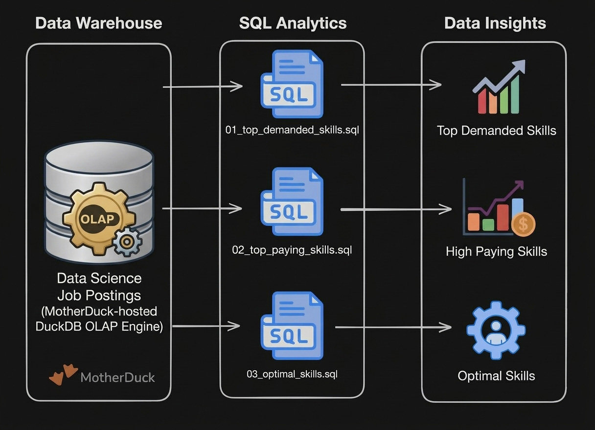

# Data Engineering Projects

Hands-on projects to reinforce core data engineering concepts from the SQL for Data Engineering course.

# Projects

## [1_EDA/](./1_EDA/) - Exploratory Data Analysis

SQL-driven analysis of data engineer job market trends using advanced querying techniques.

1. [01_top_demanded_skills.sql](./1_EDA/01_top_demanded_skills.sql)
2. [02_top_paying_skills.sql](./1_EDA/02_top_paying_skills.sql)
3. [03_optimal_skills.sql](./1_EDA/03_optimal_skills.sql)

**Skills**: Complex joins, aggregations, analytical functions, data quality validation

### [2_WH_Mart_Build/](./2_WH_Mart_Build/) - Data Pipeline - Data Warehouse & Mart
End-to-end ETL pipeline transforming raw CSV files into a star schema data warehouse and analytical data marts.

**Skills**: Dimensional modeling, ETL pipeline development, data mart architecture, production practices

## [3_Flat_to_WH_Build/](./3_Flat_to_WH_Build/) - Flat to Warehouse Build

SQL-driven transformation of flat job posting data into a normalized star schema using DuckDB.

**Skills**: Data transformation, star schema design, ETL pipeline development, production practices